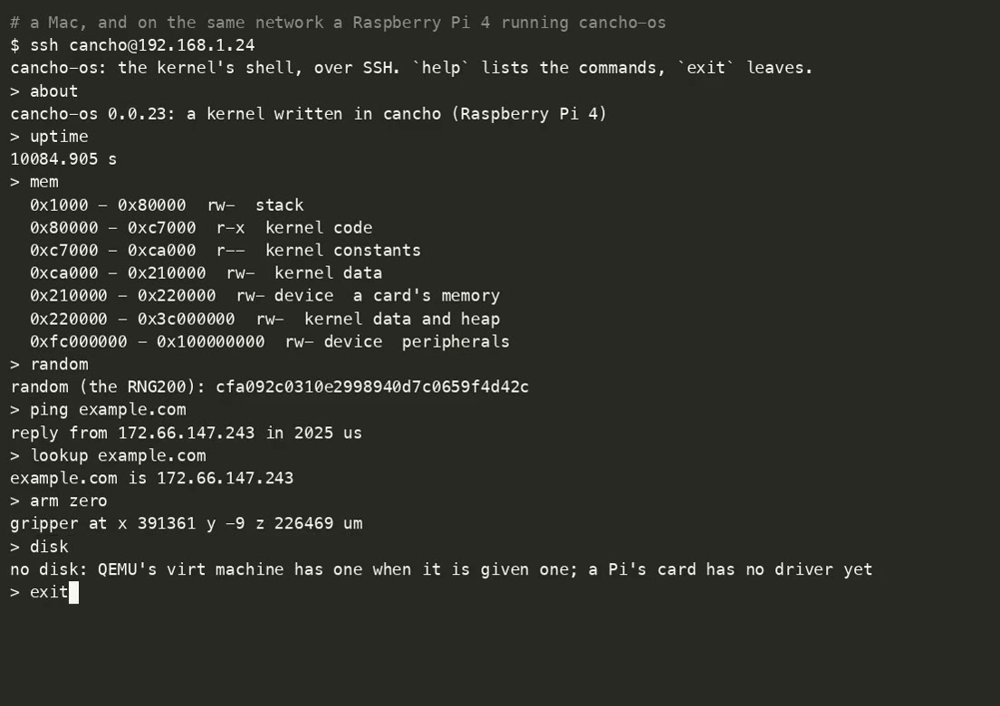

# cancho-os — an operating system written in cancho, on bare metal

Site: https://alpibrusl.github.io/cancho-os/

[](docs/demo/pi4-ssh.mp4)
*A real session, 2026-11-26: a Mac logs in over SSH to the kernel on a Raspberry Pi 4 on a home network. Only
the typing is scripted ([`docs/demo/session.py`](docs/demo/session.py)); re-render with `agg` and `ffmpeg` from
[`docs/demo/pi4-ssh.cast`](docs/demo/pi4-ssh.cast).*

**Where it stands** (2026-11-26):

- **On a real Raspberry Pi 4:** it boots, gets an address from a home router through its own Ethernet card,
  resolves names, and gives its shell over SSH. One board, one network.
- **In QEMU, on every change:** all of that, as a Pi 3, a Pi 4 and QEMU's `virt` machine; and a FAT disk read.
- **Not yet:** writing files, the SD card on a real board, separate programs, moving a servo, the Pi 5
  (its code is written from the board's device tree and has never run).

Raspberry Pi first. Nothing in the design is tied to it: the shell, the servo
protocol, the kinematics and the safety core are plain cancho, and what is specific to the
board is the boot assembly, the drivers and the page-table format. A PC with UEFI is the
planned second target (docs/ROADMAP.md).

The firmware loads `kernel8.img`, a page of assembly drops to EL1 and calls `main`, and
everything after that is cancho: the drivers, the page tables, the network stack, the shell.
There is no Linux or libc under it and no C in this repository; what is not cancho is that
page of assembly and the board's own firmware.

```
src/kernel.cho   the kernel: boot, memory, the shell, the servo and arm commands (cancho)
src/base.cho     the console's output, the clock, bytes on the second serial port
src/network.cho  the kernel's side of the network: both links, the generator, the commands
src/feetech.cho  the Feetech servo protocol, read side only        } vendored from
src/calibration.cho, kinematics.cho, so101.cho  ticks to degrees,  } cancho-robot,
                 and the SO-101's forward kinematics               } unchanged
src/safety.cho   the safety core: one `approve` every motion must pass }
src/fat.cho      a FAT volume's sectors, read; holds no hardware
src/disk.cho     a disk (virtio-blk), and the commands that read files from it
src/sshd.cho     the loop between cancho-ssh and the shell
src/inet.cho     the network's packets: SLIP, Ethernet, IPv4, UDP, TCP, DHCP, DNS; holds no hardware
sim/servos.cho   six simulated servos for QEMU: a program for the host, not in the image
sim/expect.cho   what `arm pose` must print for them, computed on the host
sim/netpeer.cho  the other end of the network link for QEMU, also a program for the host
board/boot.S     boot (park cores 1-3, EL2 -> EL1, stack, zero .bss) and the exception stub.
                 Nothing in it is called by cancho
board/link.ld    load at 0x80000; code, constants and data on page boundaries; the
                 translation tables at 2 MB
build.sh         cancho build --target aarch64-none-elf, assemble boot.S, link twice (Pi, virt), objcopy
authority.sh     what the kernel can touch is docs/authority.txt, and a function lent one
                 device cannot use another (what CI runs)
run.sh           boot it in QEMU
test.sh          boot it in QEMU, type the given lines, print the UART (what CI runs)
```

Hardware is a capability. A register is reached through an `Mmio`, whose type names the
addresses it holds (cancho `docs/mmio.md`): `main` is given every address and cuts it into
eight pieces that share none (the console, its pin register, the interrupt controller, the
servo bus, the translation tables, the kernel's code to read, two bytes for the
`crash` commands, and the word where a fault is noted), and each function is lent the pieces it needs. So the function that
prints a character has this type, and the compiler holds it to it:

```
fn putc[&mc, &s](con: &!mc Mmio("0x3f201000..0x3f201048,0xfe201000..0xfe201048"), k: &!s [int], c: int)
    -> [mmio("0x3f201000..0x3f201048,0xfe201000..0xfe201048")] int
```

It cannot reach the servo bus: `./authority.sh` builds a copy of the kernel in which a
function lent only the console writes to the bus, and requires the compiler to refuse it.
The processor's own registers work the same way, through the `Cpu` capability (cancho
`docs/cpu.md`): `cpu_read(cpu, "cntvct_el0")` is one instruction, and the row of a function
names each register it reaches, so the one that advances the timer is
`fn tick(cpu: &!Cpu, ...) -> [cpu("cntv_cval_el0")]` and cannot turn the MMU off.

The kernel calls no foreign code at all. The same script holds `cancho authority` on it to
[`docs/authority.txt`](docs/authority.txt): every address and every system register the
kernel touches, and the line "never touches ... foreign code". The vendored robot modules
(protocol, kinematics, safety) take no capability at all.

What this does not show: that an address is the device the comment says it is (that is the
datasheet's word), that a value written to a register is a sane one, or anything about the
page of assembly that runs before `main`.

Two choices keep everything in cancho without the compiler's help:

- **Interrupts are polled.** They stay masked in the CPU; the timer still raises its line,
  which wakes `wfi`, and the kernel then asks the interrupt controller what happened. No
  handler runs behind the program's back, so there is no state shared with one.
- **A fault enters `main` again.** The exception stub records ESR/ELR/FAR, resets the
  stack and calls `main`, which sees the record, reports it on the UART and halts.

## Build and run

Needs a `cancho` with the bare-metal target (cancho `docs/freestanding.md`; in the cancho
repo, `sh scripts/build-standalone.sh --out /tmp/cancho-out --rev $(git rev-parse HEAD)`, then
`CANCHO=/tmp/cancho-out/cancho`), clang, ld.lld, llvm-objcopy, qemu-system-aarch64.

```sh
./build.sh && ./run.sh            # QEMU raspi3b
./test.sh about ticks crash       # scripted: type three lines, print what came back
MACHINE=raspi4b ./test.sh about   # the same image as a Pi 4 (QEMU >= 9)
SERVOS=1 ./test.sh 'servo scan'   # with the simulated servo bus on the second serial port
```

On macOS: `brew install llvm lld qemu` and put `$(brew --prefix llvm)/bin` on `PATH`
(Apple's clang has no `llvm-objcopy`).

Shell: `help`, `about`, `echo <text>`, `uptime` (from the ARM counter), `ticks` (timer
interrupts taken), `mem` (the memory map), and three ways to fault on purpose, each named
by the kernel with ESR/ELR/FAR before the core halts: `crash` (out-of-bounds
read, caught by cancho's own check), `crash null` (page 0 is unmapped), `crash write`
(kernel code is read-only). `servo scan` and `servo pos` are described below.

## The robot

The first real job for cancho-os is the safety controller of a robot arm (the SO-101 arms
of [cancho-robot](https://github.com/alpibrusl/cancho-robot)): a machine where the only
program that can reach the servo bus is the one the kernel hands it to.

Today the kernel can talk to the bus and only read: `servo scan` pings ids 1 to 8,
`servo pos` reads each servo's position. It contains no packet that can move a servo.

It also knows where the arm is. `arm pose` reads the five joints, turns ticks into degrees
with the arm's calibration and runs the SO-101's forward kinematics; `arm zero` does the
same for the all-zero pose, with no bus. That code is cancho-robot's, where it is held to
LeRobot and to the placo solver. Two checks say it computes the same with no system under
it: `arm zero` prints the position placo gives (391361, -9, 226469 micrometres), and
`arm pose` prints, line for line, what the same sources print when built for the host
(`build/expect`). Both compare at the printed precision (a micrometre, a thousandth of a
degree), not bit for bit.

And it can judge a motion without making it. `arm check 5 14 33 -41 44` asks the safety
core (cancho-robot's `safety.approve`, unchanged) whether the arm may go to those five
angles from where it is: joint limits, the workspace, the jump bound, collisions with the
tower and the tray, then the speed clamp. It answers `approved` with the goals it would
send, or `refused:` with the rule, and always ends `nothing was sent`. CI sends four
requests with four different verdicts and compares them with the host, as above. Actually
sending a goal waits for cancho-robot's actuation core, which is still in review there.
In QEMU the bus is the board's second serial port, connected by `test.sh` to
`sim/servos.cho`. The simulator is a model written from the protocol, not a recording of
a servo, so it can share a misreading with the driver; the real check is the arm.

The target board is a Pi 5, which QEMU does not model. What changes there is the address
table and the four `bus_` functions (a PL011 behind the RP1 chip instead of the mini
UART); the protocol, and everything built on it, does not. Not verified in QEMU: timing at
1 Mbaud, half-duplex behaviour, RP1.

## Randomness

`random` prints sixteen bytes from the board's own generator: virtio-rng on QEMU's `virt`, the BCM2835
generator on a Pi 3, the RNG200 on a real Pi 4 (started by `net eth`, since QEMU's Pi 4 has neither it
nor the card). The kernel keeps a few words ready and begins each TCP connection at one.
[docs/random.md](docs/random.md).

## The network

The kernel answers `ping`, a UDP echo and a TCP echo (port 7) over two links: a serial line
(SLIP) on the second serial port of a Pi, and Ethernet, with ARP, through a virtio network card
on QEMU's `virt` machine. It can also speak first: `ping 10.0.0.1` in its shell, and `http 10.0.0.1 8000` opens a connection
and prints the page a web server there gives. On the card, `net dhcp` asks the network for an address,
a gateway and a name server, after which names work (`lookup example.com`, `http example.com 80`):
[docs/addresses.md](docs/addresses.md). And `net shell on`, typed at the serial
console, gives that shell to whoever connects to port 23 (`nc 10.0.0.2 23`): no password and no
encryption, so only on a cable you trust, and only until SSH replaces it. TCP here is small
on purpose: connections are opened from the other end only, and at most one segment's worth of
data (966 bytes) is unacknowledged at a time. No real network card yet: QEMU's Pi 4 has no Ethernet controller, so the Pi's own is
for the day a board boots. [docs/network.md](docs/network.md) has the reasoning and what is
checked; [docs/drivers.md](docs/drivers.md) the order of the drivers.

```
NET=1 ./test.sh 'net up' 'echo wait' 'echo wait' net   # sim/netpeer.cho is the other end of the line
sudo ./ping.sh                                          # Linux: the system's own ping, over a pty
MACHINE=virt UDP=hello ./test.sh 'net up' net           # Ethernet: a datagram from this machine to the kernel
MACHINE=virt TCP=hello ./test.sh 'net up' 'ping 10.0.0.1' net   # a TCP connection, and the kernel's own ping
MACHINE=virt RSH='about\nmem\n' ./test.sh 'net up' 'net shell on' net   # the kernel's shell, over a connection
sudo MACHINE=virt ./ping.sh                             # Linux: ping over a tap interface, ARP first
```

```
> net up
link up: SLIP on the second serial port, address 10.0.0.2
0 packets answered, 0 dropped
> net
link up: SLIP on the second serial port, address 10.0.0.2
3 packets answered, 1 dropped (the last: checksum)
peer: 3 replies to 4 packets, as it should be
```

In CI the system's `ping` on Linux gets 5 replies to 5 requests from the kernel in QEMU.

The code that reads packets from outside, `src/inet.cho`, holds no capability: its functions have
the empty row, so it cannot reach a register or a servo. The kernel's authority report did not
change when the network was added.

## On a real Pi 4

**It boots.** On 2026-11-26 version 0.0.17 ran on a real Raspberry Pi 4 Model B, from the
steps below, with the Pi's firmware of April 2021. One board, one session:

- `about` said `(Raspberry Pi 4)`; `help`, `echo` and `mem` answered as in QEMU.
- **The timer and the interrupt controller:** `ticks` rose by 100 a second, and over 21.006 s of
  another machine's clock `uptime` advanced 21.000 s.
- **The MMU and the caches** were on throughout. `crash null` gave `data abort: address not
  mapped`, with `far 0x0000000000000000`, and halted.
- **Floating point:** `arm zero` printed `gripper at x 391361 y -9 z 226469 um`, the same digits
  as in QEMU and as the reference it is checked against.
- `servo scan` found no servo, and `random` no generator: both as expected (below).

The console was a second Pi's header UART, read over SSH: three wires, pin 6 to pin 6 and pins 8
and 10 crossed.

**And it is on the network.** The same day, with the board cabled to a home router: `net eth` found
the card and the cable at 1000 Mb/s, `net dhcp` got an address from the router, `http example.com 80`
printed the page, and a Mac on the network pinged the kernel, used its TCP echo (200,000 bytes back
in 1 s) and its shell. [docs/genet.md](docs/genet.md). Everything else in this file was still
measured in QEMU.

You need a Raspberry Pi 4, a microSD card and a USB-serial cable with **3.3 V** levels (a
5 V one damages the pins).

1. **Build the image** (above): `./build.sh` writes `build/kernel8.img`, about 64 KB.
2. **Put the firmware on the card.** The Pi's own firmware loads the kernel; it is not part
   of this repository. Either flash Raspberry Pi OS Lite with Raspberry Pi Imager, which
   leaves the firmware on the card's FAT partition (`bootfs`), or format the card FAT32 and
   copy `start4.elf` and `fixup4.dat` from
   https://github.com/raspberrypi/firmware/tree/master/boot.
3. **Copy two files** to that partition, replacing what is there: `build/kernel8.img` and
   `board/config.txt`. On a Mac with the card mounted as `bootfs`:

   ```
   cp build/kernel8.img board/config.txt /Volumes/bootfs/ && diskutil eject /Volumes/bootfs
   ```

   `config.txt` is four lines: 64-bit, this kernel, the UART on, and `disable-bt`, which
   puts the PL011 on GPIO14/15 instead of the Bluetooth chip.
4. **Wire the cable** to the 40-pin header: GND to pin 6, the cable's RX to pin 8 (GPIO14,
   the Pi's TXD), the cable's TX to pin 10 (GPIO15, the Pi's RXD). Leave the cable's power
   wire unconnected.
5. **Open the console, then power the Pi.** 115200 baud, 8N1:

   ```
   screen /dev/cu.usbserial-XXXX 115200      # macOS; the name depends on the cable
   picocom -b 115200 /dev/ttyUSB0            # Linux
   ```

   It should print ``cancho-os booted. type `help`.``, and `about` should say `(Raspberry Pi 4)`.
   Then `ticks`, `uptime`, `crash null`.

What QEMU does not model, so where a real board may differ:

- **The data cache.** The boot stub now empties the caches before the kernel turns them on
  (docs/load.md says what was seen without that). On the board it has run only at the start of
  kernels sent with `load`, not yet at a power-on.
- **The UART clock.** The divisor is for 48 MHz, the Pi 4's default. Garbage on the console
  points here (`init_uart_clock=48000000` in `config.txt` pins it).
- **The servo bus does not work on a Pi 4 header yet.** It is the mini UART, whose only
  header pins are the two the console uses. It has to move to another PL011 (UART3, on
  GPIO4/5) before a real arm can be read.

## On a real Pi 5

**Written, never run.** QEMU has no Pi 5, so this code has not executed anywhere:
[docs/pi5.md](docs/pi5.md) says where every address came from and what is not known. On a Pi 5 the
kernel has its console, the timer, the memory map and the shell; no servo bus, no network, no randomness.

You need a microSD card and a cable for the **debug connector** (three pins, between the HDMI ports;
Raspberry Pi's Debug Probe has one). The 40-pin header's pins are not the console here.

1. `./build.sh`.
2. Format the card FAT32 and copy three files to it: `build/kernel8.img`, `board/config.txt`, and
   `bcm2712-rpi-5-b.dtb` from https://github.com/raspberrypi/firmware/tree/master/boot (the kernel does
   not read it; the boot loader may want it there). A Pi 5 needs no `start.elf`: its firmware is in the
   board's own memory.
3. Connect the cable, open the console at 115200 baud, put the card in and power the Pi. The boot
   loader prints first, on the same port. Then: ``cancho-os booted. type `help`.``, and `about` should
   say `(Raspberry Pi 5)`.

A Pi 5 tries the SD card before its other disks by default (`BOOT_ORDER=0xf461`: check yours with
`rpi-eeprom-config`). So what is installed on an NVMe drive is not touched, and boots again when the
card is taken out.

## Files

On QEMU's `virt` machine the kernel reads a FAT16 or FAT32 disk ([docs/storage.md](docs/storage.md)):
`disk`, `ls`, `cat <name>`, `sum <name>`, and it can add to one: `write <name> <text>`,
`append <name> <text>`, `copy <from> <to>`. It never replaces or removes a file (that waits for
versions: [docs/permissions.md](docs/permissions.md)). The top directory only, short names only; a
real Pi's SD card has no driver yet.

```
MACHINE=virt DISK=some-fat.img ./test.sh disk ls 'sum KERNEL8.IMG'
```

## SSH

`net ssh on`, at the serial console, puts the kernel's shell behind SSH on port 22
([docs/ssh.md](docs/ssh.md)). SSH itself is [cancho-ssh](https://github.com/alpibrusl/cancho-ssh), built
in from a checkout beside this one; who may log in is built in too:

```
git clone https://github.com/alpibrusl/cancho-ssh ../cancho-ssh
AUTHORIZED=~/.ssh/id_ed25519.pub ./build.sh       # that key may log in, and no other
ssh anyone@<the kernel's address> about            # after `net ssh on`: the host key is on the console
```

It works in QEMU and on a real Pi 4. The host key is new at every start (there is nowhere to keep it),
there are no passwords, and cancho-ssh has not been reviewed: for a network you trust.

## A new kernel without moving the card

`load <bytes>`, at the serial console, takes a kernel over that line and starts it in place of the
running one, if the sender confirms its checksum: [docs/load.md](docs/load.md). From the machine wired
to the console:

```
python3 board/send.py /dev/ttyAMA0 build/kernel8.img
```

It does not write the card: a power cycle brings back the card's kernel. `./load.sh` does the same in QEMU.

## How it is built, and what is left to remove

- `cancho build --target aarch64-none-elf --emit obj` writes an ELF object with no libc in
  it: regions take their 64 KB chunks from the memory `board/link.ld` names
  (`__cancho_heap_start` to `__cancho_heap_end`), and `memset`/`memcpy` are the module's
  own. `nm -u` on the kernel object lists those two symbols and nothing else.
- What is left outside cancho is `board/boot.S`: boot and the exception stub, which run
  before `main` or instead of it. The eleven primitives it used to export are gone:
  cancho has loads and stores behind the `Mmio` capability (edition 13) and system
  registers behind `Cpu` (edition 14). What the kernel needs from the link is two words
  at a fixed place in the image, and the fault stub leaves one word saying which vector.

Context and decisions: [`docs/ROADMAP.md`](docs/ROADMAP.md). Compiler issues to file in cancho: [`docs/issues/`](docs/issues/).

## Next milestones

3. (identity map done) kernel/user split, together with
4. tasks, scheduler, capability IPC
5. framebuffer via the firmware mailbox
6. SD card + FAT

## Licence

[EUPL-1.2](LICENSE). Which hardware is supported, and what each driver is written from, is in
[docs/drivers.md](docs/drivers.md): a driver follows a permissively licensed reference so that
the whole stays under this licence.
